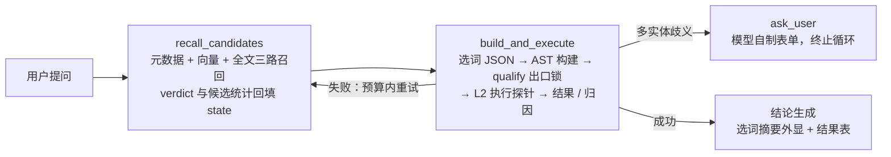

# nl2sql-agent

面向企业内部业务与管理人员的（B2B）自助数据查询 Agent：自然语言提问 → 元数据召回 → 模型只做「选词」 → 程序基于
[SQLGlot](https://github.com/tobymao/sqlglot) 构建 SQL AST 并做出口校验 → 执行 → 结果比对与结论生成。

> 核心立场：**模型不生成 SQL 文本，只输出结构化选词** —— 表 / 列 / 聚合全部来自程序侧的白名单与元数据，
> 从架构上杜绝「编造不存在的表和列」。

## 三个关键架构决策

### 1. 选词拼 AST，而不是让模型写 SQL

LLM 自由生成 SQL 无法保证表与列真实存在，语义漂移在链路内部不可自证。
改为：LLM 只输出结构化 JSON 选词（stores / select / metrics / group_by / where / order_by / having / limit），
程序按星型关系推导 join 链、逐段拼装 `exp.Select()`，所有产出统一过 `qualify` 列校验（**出口锁**），编造列直接抛错。

### 2. 单 `create_agent` 闭环

整条链路收敛为 1 个 `create_agent` 节点（ReAct 循环），**分支决策移交模型**：

| 维度 | 设计 |
|---|---|
| 编排 | 1 个 `create_agent` 节点 |
| 工具 | 3 个：`recall_candidates` / `build_and_execute` / `ask_user` |
| 澄清 | `ask_user` 工具，任意时刻可触发（模型自制表单 + 终止循环，无需 checkpointer） |
| 纠错 | 动态轮次：初始预算 5 ⇒ 异常路径恰好 3 次机会，正常路径净消耗 0 |

### 3. 工具的边界 = 模型的决策点

无独立决策点的连续动作应合并：4 个候选工具收敛为 3 个（「扩写关键词」并入召回、「生成 + 执行」合并），
省一轮 LLM 往返；约束从 system prompt 迁往 tool description（prompt 管行为，tool description 管边界）。

## 链路总览



可靠性机制：

- **动态轮次与预算**：`ControlMiddleware` 三层记账（思考 −1 / 工具成功 +1 / 工具失败 −1），异常路径限重试、正常路径零额外消耗
- **预算锁**：失败率记账 + 阈值告警（5% / 10%），失败归因 3 类（`select` / `structure` / `backbone`），12 处 raise 统一打标
- **执行探针（L2）**：`LIMIT cap+1` 执行，以返回行数判定命中 / 截断 —— 取代 `EXPLAIN`（语法校验与 qualify 重叠，拦不住「0 行 / 答非所问」）

## 权限与安全边界

**查库是敏感操作，「谁能查」必须在请求进入 Agent 之前解决。** 本项目定位 B2B 企业内网场景：
身份认证与权限校验前置在统一认证 / 网关层完成（企业内部系统的标准分层），本仓库聚焦 NL2SQL 链路内核，不自带账号体系——
进入 Agent 的会话视为已通过前置授权。

Agent 链路内部的安全防线（按构造成立，不依赖模型自觉）：

- 只读查询：SQL 由 `exp.Select()` 逐段装配，链路在结构上只产出 `SELECT`，不存在生成 `UPDATE` / `DELETE` / `DDL` 的路径
- 出口锁：所有产出统一过 `qualify` 列校验，引用不存在表 / 列的语句直接抛错
- 行数上限：执行探针以 `LIMIT cap+1` 执行，兼作截断检测
- 最小暴露：模型可见的只有元数据白名单（召回候选），拿不到连接串、密钥与库表全集

## 代码导览

```
app/
├── agent/
│   ├── recall.py              # 召回链路：元数据 + 向量(Qdrant) + 全文(ES) 三路融合
│   ├── ast_builder.py         # ★ 纯函数 AST 构建：选词 JSON → sqlglot AST → qualify 出口锁
│   └── agent/
│       ├── builder.py         # create_agent 装配（对外唯一入口）
│       ├── sqlflow.py         # join 键 / 指标列补全 + L2 执行探针
│       ├── tools/             # 3 个工具（recall / build_and_execute / ask_user）
│       └── middleware/        # 动态轮次预算 + 澄清终止循环
├── services/query_service.py  # astream_events(v3) 驱动 + SSE 推送（前端契约 5 类事件）
├── clients/                   # MySQL / Qdrant / ES / embedding 客户端管理
└── conf/                      # OmegaConf 配置模型
```

## 评测结果

分层问题集 × 参考 SQL 执行结果比对（详见 [docs/measurements](docs/measurements/README.md)）：

| 指标 | 值 |
|---|---|
| 命中率（值 + 行数与参考一致） | **10/10**（分层评测集：分组聚合 / TopN / 多值筛选 / 多表关联） |
| 平均单问 LLM 调用 / 工具调用 | 3.2 次 / 2.1 次 |
| 预算消耗 | min 1 / avg 1.2 / max 3（初始 5），9/10 正常路径零惩罚 |
| 离线测试 | pytest 57 例，全部离线可跑（无需 LLM / 数据库） |

量测暴露并修复的三个真实缺陷（元数据指错列 / `IN` 值形态缺口 / 聚合表达式误判表名）——
**发生时在线链路全部绿灯**，只有「与参考 SQL 做执行结果比对」才暴露得出来。详见评测文档。

## 运行

本仓库不含数据与凭据。运行需要自备：MySQL（meta 元数据库 + dw 数据仓库）、Qdrant、Elasticsearch、
任意支持 function calling 的 OpenAI 兼容 LLM 端点。复制 `conf/app_config.yaml` 模板填入你的连接信息即可。
架构说明以代码与注释为准——核心逻辑集中在 `app/agent/` 约 10 个文件内。
